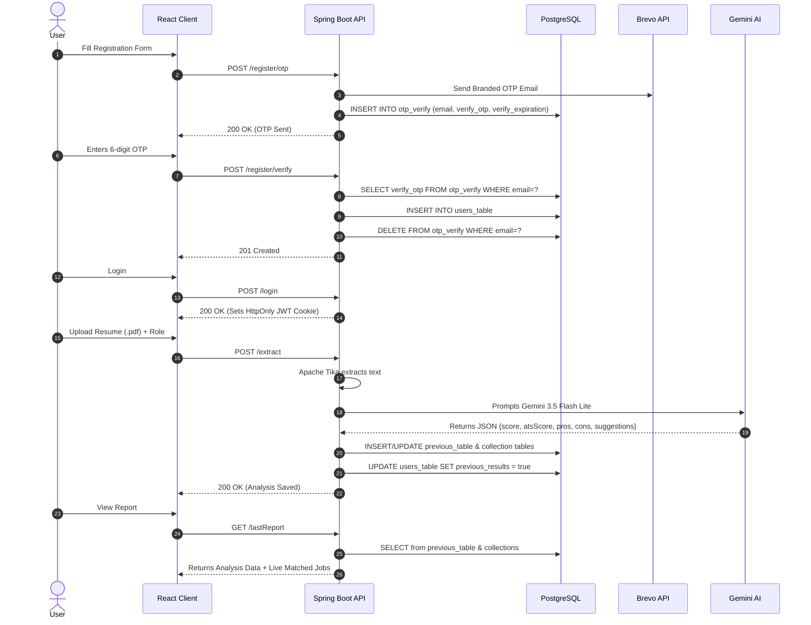

# 🚀 AI-Powered Resume Analyser & ATS Auditor

<p align="center">
  
  
  
  
  
</p>

An enterprise-grade, full-stack career acceleration platform that evaluates resumes against industrial **Applicant Tracking Systems (ATS)** using **Google Gemini AI**. The application provides deep section-by-section breakdown (Strengths, Skill Gaps, Actionable Recommendations) with radial progress gauges, real-time live job recommendations via **Adzuna API**, and secure user authentication with **Brevo Transactional Email OTP verification**.

---

## 🌟 Key Features

- **🤖 Enterprise AI Resume Evaluation**:
  - Uses Apache Tika for multi-format text extraction (`.pdf`, `.docx`, `.doc`).
  - Google Gemini AI prompt engineered for industrial ATS metrics (Keyword saturation, standard section headings, typography, quantifiable metrics).
  - Produces dual holistic scores: **Overall Profile Score** & **ATS Compatibility Score**.
- **📊 Intuitive Dashboard & SVG Visualizations**:
  - Custom SVG circular score meters with reactive color states.
  - Granular breakdown of **Strengths**, **Critical Skill Gaps**, and **Priority Action Items**.
  - Section-wise categorization (Technical Stack, Projects, Education, Layout).
- **💼 Real-Time Job Opportunities**:
  - Integrated with **Adzuna Jobs API** to pull live job openings matching the candidate's target job role and location.
- **🔐 Robust Security & Authentication**:
  - Dual authentication: Standard Email/Password and **Google OAuth2 SSO**.
  - Passwords hashed with **BCrypt**.
  - Stateless authentication using **JWT (JSON Web Tokens)** stored in secure `HttpOnly`, `SameSite=Strict` cookies to defend against XSS & CSRF attacks.
  - 6-digit OTP verification for both registration and self-serve password resets via **Brevo Email API**.
- **🎨 Ultra-Modern Glassmorphic Dark UI**:
  - Deep space theme (`#07090e`, neon cyan `#60efff`, and cobalt blue `#0061ff`).
  - Responsive layout built with vanilla modular CSS.

---

## 🏗️ System Architecture & Workflow

```
[ User Browser (React 19 + Vite) ]
          │
          │  REST API Calls with HttpOnly JWT Cookie
          ▼
[ Spring Boot 3.5.5 Backend ] ────► [ PostgreSQL Database ]
   │         │               │         ├── users_table
   │         │               │         ├── otp_verify
   │         │               │         ├── previous_table
   │         │               │         ├── previous_table_pros
   │         │               │         ├── previous_table_cons
   │         │               │         └── previous_table_suggestions
   │         │
   │         ├──► [ Apache Tika ] ──► Parses PDF/DOCX into clean plain text
   │         │
   │         ├──► [ Google Gemini AI API ] ──► Strict ATS Audit & Scoring Engine
   │         │
   │         ├──► [ Brevo Email API ] ──► Transmits OTP Emails with Custom HTML Templates
   │         │
   │         └──► [ Adzuna Jobs API ] ──► Fetches live job openings by role
```

---

## 🗄️ Database Schema & Entities

The relational database architecture is managed with **PostgreSQL 16** and **Spring Data JPA (Hibernate)**:

### 1. `users_table`
Stores registered user accounts, encrypted credentials, and historical analysis flags.
- `email` *(VARCHAR - PRIMARY KEY)*: Unique user identifier.
- `username` *(VARCHAR)*: Display name.
- `password` *(VARCHAR)*: BCrypt salted password hash.
- `previous_results` *(BOOLEAN)*: Flag indicating if user has analyzed at least one resume.
- `reset_otp` *(VARCHAR)*: 6-digit temporary password reset code.
- `reset_expiration` *(TIMESTAMP)*: Expiration cutoff for reset OTP.
- `created_at` / `update_at` *(TIMESTAMP)*: Auditing timestamps.

### 2. `otp_verify`
Temporary cache table for email verification during account signup.
- `email` *(VARCHAR - PRIMARY KEY)*: Pending registration email.
- `verify_otp` *(VARCHAR)*: 6-digit verification code.
- `verify_expiration` *(TIMESTAMP)*: Expiry time (15 minutes).

### 3. `previous_table`
Stores the high-level resume analysis report.
- `email` *(VARCHAR - PRIMARY KEY)*: Foreign reference to user.
- `score` *(INTEGER)*: Overall candidate rating (0–100).
- `atsoptimizationscore` *(INTEGER)*: ATS parsing & keyword score (0–100).
- `roles` *(VARCHAR)*: Target job role specified by candidate.

### 4, 5 & 6. Collection Tables (`@ElementCollection`)
Generated automatically by Hibernate to store 1-to-many list items for each user's analysis:
- **`previous_table_pros`**: Normalized rows storing resume strengths (`previous_table_email`, `pros`).
- **`previous_table_cons`**: Normalized rows storing resume weaknesses (`previous_table_email`, `cons`).
- **`previous_table_suggestions`**: Normalized rows storing concrete improvement steps (`previous_table_email`, `suggestions`).

---

## 🔄 End-to-End Application Lifecycle



---

## 🛠️ Tech Stack Breakdown

| Layer | Technology | Details |
| :--- | :--- | :--- |
| **Frontend** | React 19, Vite, Vanilla CSS | Responsive modular glassmorphic design, custom SVG gauges |
| **Backend** | Spring Boot 3.5.5, Java 17 | RESTful API, Spring Security 6, Spring Data JPA |
| **Database** | PostgreSQL 16 | Relational data persistence with normalized collections |
| **AI Engine** | Google Gemini (3.5 Flash Lite) | Prompt-engineered strict ATS evaluator |
| **Parser** | Apache Tika | Plain text extraction from `.pdf`, `.doc`, `.docx` |
| **Mailing** | Brevo (Sendinblue API) | Transactional OTP emails with custom Thymeleaf templates |
| **Jobs API** | Adzuna Job Search API | Live role-based job vacancies and location matching |

---

## ⚙️ Local Setup Guide

### 1. Prerequisites
- **Java 17** (Amazon Corretto 17 recommended)
- **Node.js 18+** & npm
- **PostgreSQL 16** running locally on port `5432`

### 2. Database Configuration
Create a database named `resume_analyser` in PostgreSQL:
```sql
CREATE DATABASE resume_analyser;
```

Update credentials in `src/main/resources/application.properties`:
```properties
spring.datasource.url=jdbc:postgresql://localhost:5432/resume_analyser
spring.datasource.username=postgres
spring.datasource.password=YOUR_POSTGRES_PASSWORD

# Brevo Mail API
apiKey=YOUR_BREVO_API_KEY

# Google Gemini API
genKey=YOUR_GEMINI_API_KEY

# Adzuna Jobs API
application-id=YOUR_ADZUNA_APP_ID
application-api-key=YOUR_ADZUNA_API_KEY

# JWT Secret (HS256)
jwt-key=YOUR_256_BIT_SECRET_KEY
```

### 3. Run Backend (Spring Boot)
```powershell
$env:JAVA_HOME = 'C:\Path\To\jdk-17'
$env:Path = "$env:JAVA_HOME\bin;$env:Path"
.\mvnw.cmd spring-boot:run
```
Backend runs on: `http://localhost:8080`

### 4. Run Frontend (React + Vite)
```powershell
cd "frontend src"
npm install
npm run dev
```
Frontend runs on: `http://localhost:5173`

---

## 📜 License
This project is open-source and available under the [MIT License](LICENSE).
`